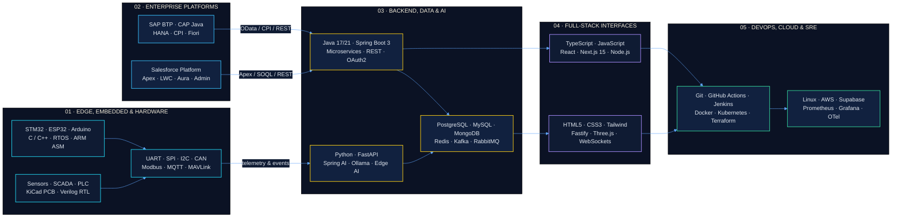

<!-- ══════════════════════════════════════════════════════════════════════════════
     MADAN PATEL H S — FUTURISTIC MULTI-STACK ENGINEERING DASHBOARD
     Single-file GitHub Profile README · Hero · Identity · 8-Domain Tech Matrix ·
     Complete 19-Repository Showcase · Contribution Telemetry · Architecture Map
     ══════════════════════════════════════════════════════════════════════════════ -->

  

  

  
  
  
  
  
  

  
    <a href="#identity"><b>01 · IDENTITY</b></a> &nbsp;·&nbsp;
    <a href="#stack"><b>02 · TECH STACK (8 DOMAINS)</b></a> &nbsp;·&nbsp;
    <a href="#repositories"><b>03 · REPOSITORIES (19)</b></a> &nbsp;·&nbsp;
    <a href="#telemetry"><b>04 · TELEMETRY</b></a> &nbsp;·&nbsp;
    <a href="#architecture"><b>05 · ARCHITECTURE</b></a> &nbsp;·&nbsp;
    <a href="#connect"><b>06 · CONNECT</b></a>
  

  
  
  
  
  

<h2 align="center">◈ 01 · IDENTITY PANEL</h2>

<table>
<tr>
<td width="34%" valign="top" align="center">
   
  
    
  <b>MADAN PATEL H S</b> 
  <code>@Madanpatel21</code>
    
  <b>Software Developer | Embedded Systems | Multi-Stack Engineering</b> 
  Aspiring Digital Transformation Consultant
    
  B.E. — Electrical &amp; Electronics Engineering (2025) Karnataka, India
    
  
  
   
  
    
  
    <b>19</b> public repositories · <b>8</b> technical pillars 
    <b>Silicon · Services · Enterprise · Cloud</b>
  
</td>
<td width="66%" valign="top">
  

    
    
    
  

  

    I engineer systems end to end — uniting <b>Embedded C/C++ firmware (STM32, ESP32, Arduino, RTOS)</b>,
    <b>Java 17/21 &amp; Spring Boot backend microservices</b>, <b>enterprise transformation platforms (SAP BTP &amp; Salesforce)</b>,
    and <b>modern TypeScript / React / Next.js full-stack interfaces</b> backed by containerized <b>DevOps &amp; Cloud</b> workflows.
    Trained in Electrical &amp; Electronics Engineering, I approach software from physical constraints upward: deterministic timing,
    clean protocol contracts, fault tolerance, and observable operations.
  

  

    Across my public repositories, the emphasis is verifiable engineering over boilerplate: a <b>1&nbsp;kHz autonomous drone
    flight-control stack</b> passing 2,741 host-side checks, a <b>30-screen DevSecOps &amp; SRE release-risk control plane</b>
    with PostgreSQL 17 RLS and Welch <i>t</i>-test canary verification, an <b>industrial micro-grid Energy Management System</b>
    spanning STM32 firmware, MQTT gateway, FastAPI historian and SCADA HMI, a <b>Kafka/Redis/MongoDB Spring Boot 3 API</b>
    with Spring AI, and a <b>700-design Java 21 architecture portfolio</b>. Every repository states clearly what is delivered,
    what runs in simulation, and what is hardware-gated.
  

  

    
  

  

    Enterprise Platform Ecosystems:&nbsp;
    &nbsp;<b>SAP BTP · CAP · HANA · CPI · Fiori</b>
    &nbsp;&nbsp;|&nbsp;&nbsp;
    &nbsp;<b>Salesforce · Apex · LWC · Aura · Admin</b>
  

</td>
</tr>
</table>

<h2 align="center">◉ 3D ENGINEERING COMMAND DECK</h2>

System architecture &amp; control-plane visuals from <a href="https://github.com/Madanpatel21/DeploySentinel"><b>DeploySentinel</b></a> — processing core, AI risk telemetry, cloud infrastructure &amp; operator console.

<table>
<tr>
<td width="50%" valign="top" align="center">
  
   
  <b>CONTROL PLANE CORE</b> · Risk Engine · Security Shields · Live Telemetry
</td>
<td width="50%" valign="top" align="center">
  
   
  <b>MULTI-LAYER STACK</b> · Console UI · Compute &amp; API Tier · RLS Data Plane
</td>
</tr>
</table>

<h2 align="center">◈ 02 · CENTRAL TECHNICAL STACK DASHBOARD</h2>

Comprehensive 8-domain engineering stack — uniting repository-verified implementations across embedded firmware, Java microservices, full-stack web, data/AI, DevOps/cloud, and industrial hardware with enterprise SAP BTP &amp; Salesforce platform tracks.

<table>
<tr>
<td width="50%" valign="top">
  

    
  

  
<b>Microcontrollers, real-time scheduling &amp; field buses</b> 
  Real-time fixed-priority &amp; RTOS-style task scheduling, bus protocol framing, multi-sensor integration &amp; fusion, motor control, and host-HIL simulation across STM32F765, STM32C031, ESP32 and Arduino targets.

  

    
    
    
    
    
    
    
    
    
    
    
    
    
    
    
    
    
    
  

</td>
<td width="50%" valign="top">
  

    
    &nbsp;
  

  
<b>Cloud extension platform, service modelling &amp; integration</b> 
  Enterprise platform track catalogued in <code>engineering-universe</code> — cloud-native business services with CAP (Java), SAP HANA data persistence, CPI cross-system integration, Fiori UX and S/4HANA process domains.

  

    
    
    
    
    
    
    
    
  

  
<i>Platform &amp; digital-transformation domain in <code>engineering-universe</code>; dedicated public SAP repositories forthcoming.</i>

</td>
</tr>
<tr>
<td width="50%" valign="top">
  

    
    &nbsp;
  

  
<b>Apex logic, Lightning UI, declarative admin &amp; CRM automation</b> 
  Governor-limit-aware Apex &amp; asynchronous processing, Lightning Web Components and Aura interfaces, Salesforce Administration &amp; Flows, SOQL data access, SFDX tooling and external REST integrations.

  

    
    
    
    
    
    
    
    
    
    
  

  
<i>Declared across profile resume &amp; CRM showcase architecture (Smart Lead Management, SLA &amp; workflow automation).</i>

</td>
<td width="50%" valign="top">
  

    
  

  
<b>Spring Boot 3 services, microservices, security &amp; persistence</b> 
  Enterprise Java 17/21 backends implemented across <code>ContactsHub</code>, <code>walletapplication</code>, <code>emp_management_system</code> and 12 full projects inside the 700-system <code>Java-Project-portfolio</code>.

  

    
    
    
    
    
    
    
    
    
    
    
    
    
    
    
    
  

</td>
</tr>
<tr>
<td width="50%" valign="top">
  

    
  

  
<b>Web applications, control consoles &amp; interactive 3D interfaces</b> 
  Strict TypeScript monorepos, a 30-screen Next.js 15 + Fastify SRE console (<code>DeploySentinel</code>), a 3D React Three Fiber portfolio (<code>engineering-universe</code>), and real-time WebSocket dashboards.

  

    
    
    
    
    
    
    
    
    
    
    
    
    
    
  

</td>
<td width="50%" valign="top">
  

    
  

  
<b>Containers, orchestration, IaC, CI/CD &amp; observability</b> 
  Docker &amp; Compose stacks, Kubernetes and Terraform infrastructure in <code>DeploySentinel/infra</code>, GitHub Actions CI/CD, Linux tooling, cloud services and full-stack telemetry pipelines.

  

    
    
    
    
    
    
    
    
    
    
    
    
    
    
    
    
  

</td>
</tr>
<tr>
<td width="50%" valign="top">
  

    
  

  
<b>Databases, event brokers, historians &amp; applied AI</b> 
  Row-level-security PostgreSQL 17 &amp; PL/pgSQL schemas, MongoDB geospatial stores, Redis caching, Kafka &amp; RabbitMQ event pipelines, WAL historians, Python/FastAPI services and Spring AI + Ollama integration.

  

    
    
    
    
    
    
    
    
    
    
    
    
    
  

</td>
<td width="50%" valign="top">
  

    
  

  
<b>SCADA supervision, power electronics &amp; digital hardware</b> 
  Implemented SCADA + SVG mimic HMI &amp; alarm engine in <code>Hybrid-Portable-Micro-grid</code>, 4-layer FC PCB constraints in <code>Autonomous-Drone</code>, plus PLC, power/energy and open RTL-to-layout tracks in <code>engineering-universe</code>.

  

    
    
    
    
    
    
    
    
    
  

  
<i>SCADA/HMI &amp; EMS built in public repo; PLC, PCB/energy and VLSI/RTL explored via EEE foundation &amp; portfolio domains.</i>

</td>
</tr>
</table>

<h2 align="center">◈ 03 · REPOSITORY SHOWCASE</h2>

Complete catalogue of all <b>19</b> public repositories under <a href="https://github.com/Madanpatel21"><code>@Madanpatel21</code></a> — descriptions, stacks and statuses verified directly from repository source trees, manifests and documentation.

### ▍ FLAGSHIP SYSTEMS

<table>
<tr>
<td width="70%" valign="top">
  

    
    
    
    
  

  

    <a href="https://github.com/Madanpatel21/Autonomous-Drone-Flight-Controller-Edge-AI-Obstacle-Avoidance-"><b>Autonomous Drone Flight Controller &amp; Edge-AI Obstacle Avoidance</b></a>
  

  

    Full quadcopter flight-control stack engineered from formal requirements upward: 1&nbsp;kHz rate loop,
    250&nbsp;Hz attitude loop, fixed-priority RTOS-style deadline scheduler, quad-X mixer, DShot600 actuation,
    GNSS/baro/IMU sensor fusion, mission state machine with geofence &amp; RTL/LAND/ABORT failsafes, bounded
    advisory Edge-AI perception interface, MAVLink v2 framing and Python ground station — passing <b>2,741
    host checks</b> and <b>8 fault scenarios</b> across SIM and host-HIL targets (RC-5).
  

  

    
    
    
    
  

  
STM32 binary flash, physical 4-layer PCB, onboard AI model and live flight tests are explicitly hardware-gated in the repository.

</td>
<td width="30%" valign="top" align="center">
  
</td>
</tr>
</table>

<table>
<tr>
<td width="100%" valign="top">
  

    
    
    
    
  

  

    <a href="https://github.com/Madanpatel21/DeploySentinel"><b>DeploySentinel — Enterprise Release Risk, DevSecOps &amp; SRE Control Plane</b></a>
  

  

    Policy-driven release orchestration and risk intelligence platform: deterministic 8-dimension risk engine
    over code churn, critical paths, blast radius, SQL lock hazards, SBOM CVEs, infrastructure drift and test
    gaps, paired with Welch <i>t</i>-test statistical canary verification and human-in-the-loop rollout gates.
    Built as an npm-workspaces TypeScript monorepo with a <b>30-screen Next.js 15 console</b>, Fastify API,
    <b>PostgreSQL 17 RLS</b> (27 tables, PL/pgSQL), 9-role RBAC (32 scopes), TOTP MFA, HMAC readiness passports,
    SHA-256 hash-chained audit logs, plus Docker, Kubernetes, Terraform, Supabase and OTel/Prometheus assets.
  

  

    
    
    
    
    
  

</td>
</tr>
</table>

<table>
<tr>
<td width="50%" valign="top">
  

    
    
  

  

    <a href="https://github.com/Madanpatel21/Hybrid-Portable-Micro-grid-Design-Using-AI"><b>Hybrid Portable Micro-grid · Industrial EMS &amp; SCADA</b></a>
  

  

    End-to-end industrial Energy Management System: GCC-compiled STM32C031 firmware (64.9% flash / 28.5% RAM),
    edge gateway bridging wire frames to MQTT, deterministic simulator, FastAPI REST + WebSocket backend with
    SQLite WAL historian, and SCADA service featuring SVG mimic HMI, Modbus TCP (FC01/03/04/06), alarm rules,
    4-role RBAC and audit logging.
  

  

    
    
    
    
    
  

  
Physical board bring-up and field sensor calibration remain on the project roadmap.

</td>
<td width="50%" valign="top">
  

    
    
  

  

    <a href="https://github.com/Madanpatel21/ContactsHub"><b>ContactsHub — Event-Driven Contact Management API</b></a>
  

  

    Production-oriented backend on Java 21 and Spring Boot 3.x: MongoDB document &amp; geospatial queries,
    Redis caching, Apache Kafka event streaming, Spring Security + JWT, WebFlux reactive client, MapStruct +
    Lombok, Spring AI (Ollama) integration, SpringDoc OpenAPI/Swagger UI, Micrometer/Prometheus metrics and
    GitHub Actions CI.
  

  

    
    
    
    
    
    
  

  
Ships with Maven wrapper, interactive OpenAPI documentation and automated CI workflow.

</td>
</tr>
</table>

### ▍ ENGINEERING PLATFORMS &amp; PORTFOLIOS

<table>
<tr>
<td width="34%" valign="top">
  

  
<a href="https://github.com/Madanpatel21/Java-Project-portfolio"><b>Java-Project-portfolio</b></a>

  
Master catalogue of 700 industrial Java 21 / Spring Boot 3 system designs across 12 domains, with <b>12 implemented Maven codebases</b> under <code>projects/</code> using PostgreSQL, Flyway, OAuth 2.0, RabbitMQ, Redis, Resilience4j, Docker &amp; Prometheus.

  

</td>
<td width="33%" valign="top">
  

  
<a href="https://github.com/Madanpatel21/Madanpatel21"><b>Madanpatel21 — Profile &amp; Engineering Universe</b></a>

  
This profile dashboard plus <code>engineering-universe/</code>: a React 18, TypeScript, Vite, Tailwind, GSAP &amp; React Three Fiber 3D portfolio spanning 10 engineering domains and a 100-entry catalogue, verified with Playwright in GitHub Actions.

  

</td>
<td width="33%" valign="top">
  

  
<a href="https://github.com/Madanpatel21/Madan-Patel"><b>Madan-Patel — Earlier Profile</b></a>

  
Earlier iteration of the GitHub profile README documenting software engineering experience, Salesforce &amp; Java stack badges, education and verified contact channels.

  

</td>
</tr>
</table>

### ▍ APPLICATION BUILDS

<table>
<tr>
  <td width="27%" valign="top"><a href="https://github.com/Madanpatel21/walletapplication"><b>walletapplication</b></a> Java 17 · Spring Boot · HTML/JS</td>
  <td valign="top">Digital wallet backend and web views built with Spring Boot, Spring Security, JWT, Spring Data JPA over PostgreSQL, and Razorpay payment gateway integration.</td>
  <td width="15%" align="right"></td>
</tr>
<tr>
  <td valign="top"><a href="https://github.com/Madanpatel21/emp_management_system"><b>emp_management_system</b></a> Java 17 · Spring Boot · Maven</td>
  <td valign="top">Employee management REST application using Spring Boot, Spring Data JPA/Hibernate, bean validation, MySQL and Lombok.</td>
  <td align="right"></td>
</tr>
<tr>
  <td valign="top"><a href="https://github.com/Madanpatel21/geolocation_fetcher"><b>geolocation_fetcher</b></a> Java · Maven</td>
  <td valign="top">Compact Java/Maven HTTP client utility that queries geolocation endpoints and parses structured JSON responses.</td>
  <td align="right"></td>
</tr>
<tr>
  <td valign="top"><a href="https://github.com/Madanpatel21/Student_Grade_Tracker"><b>Student_Grade_Tracker</b></a> Java</td>
  <td valign="top">Console grade-management tool backed by <code>ArrayList</code> collections that computes class average, highest/lowest scores and student summary reports.</td>
  <td align="right"></td>
</tr>
<tr>
  <td valign="top"><a href="https://github.com/Madanpatel21/CHAT_BOT"><b>CHAT_BOT</b></a> Java</td>
  <td valign="top">Interactive console chatbot dispatching responses through Java <code>Map</code> data structures — core Java collections implementation.</td>
  <td align="right"></td>
</tr>
</table>

### ▍ OPEN SOURCE, FORKS &amp; PRACTICE

<table>
<tr>
  <td width="27%" valign="top"><a href="https://github.com/Madanpatel21/validatorjs"><b>validatorjs</b></a> JavaScript · Node.js · Fork</td>
  <td valign="top">Fork of <i>mikeerickson/validatorjs</i> — Laravel-inspired declarative data validation library for browser and Node.js runtimes.</td>
  <td width="15%" align="right"></td>
</tr>
<tr>
  <td valign="top"><a href="https://github.com/Madanpatel21/components-js"><b>components-js</b></a> TypeScript · React · Fork</td>
  <td valign="top">Fork of <i>dTelecom/components-js</i> — open-source React components and Next.js reference apps for real-time communication interfaces.</td>
  <td align="right"></td>
</tr>
<tr>
  <td valign="top"><a href="https://github.com/Madanpatel21/runanywhere-sdks"><b>runanywhere-sdks</b></a> Kotlin · Swift · On-Device AI · Fork</td>
  <td valign="top">Fork of <i>RunanywhereAI/runanywhere-sdks</i> — production toolkit for executing AI models locally across mobile targets.</td>
  <td align="right"></td>
</tr>
<tr>
  <td valign="top"><a href="https://github.com/Madanpatel21/Hacktoberfest2k25-Open-source-"><b>Hacktoberfest2k25-Open-source-</b></a> Multi-Language · Fork</td>
  <td valign="top">Fork of <i>DHEERAJHARODE/Hacktoberfest2025-Open-source-</i> — collaborative open-source repository spanning C, C++, Java, Python and JavaScript.</td>
  <td align="right"></td>
</tr>
<tr>
  <td valign="top"><a href="https://github.com/Madanpatel21/dsa-code"><b>dsa-code</b></a> C++ · Java · Python · Fork</td>
  <td valign="top">Fork of <i>ghostmkg/dsa-code</i> — multi-language data structures and algorithms problem archive for algorithmic practice.</td>
  <td align="right"></td>
</tr>
<tr>
  <td valign="top"><a href="https://github.com/Madanpatel21/DSA"><b>DSA</b></a> Algorithms Workspace</td>
  <td valign="top">Personal data-structures and algorithms practice repository, currently initialized at scaffold stage.</td>
  <td align="right"></td>
</tr>
</table>

### ▍ RESEARCH CONCEPT

<table>
<tr>
  <td width="32%" valign="top">
    <a href="https://github.com/Madanpatel21/Privacy-Preserving-Federated-Adversarial-Resilient-ADAS-Network"><b>Privacy-Preserving Federated Adversarial-Resilient ADAS Network</b></a> 
    
  </td>
  <td valign="top">Concept specification for a self-healing, decentralized, federated and adversarial-resilient ADAS AI network — currently at repository-scaffold stage and listed transparently as an early research direction.</td>
</tr>
</table>

<h2 align="center">◈ 04 · GITHUB TELEMETRY</h2>

Live contribution heatmap and streak telemetry for <code>@Madanpatel21</code>.

<table>
<tr>
<td width="100%" align="center" valign="top">
  <b>CONTRIBUTION HEATMAP · LAST 12 MONTHS</b>  
  
</td>
</tr>
<tr>
<td width="100%" align="center" valign="top">
  <b>TOTAL CONTRIBUTIONS · CURRENT &amp; LONGEST STREAK</b>  
  
</td>
</tr>
</table>

  
  

<h2 align="center">◈ 05 · MULTI-STACK ENGINEERING MAP</h2>

How all eight engineering domains connect across hardware, enterprise platforms, backend services, interfaces and cloud delivery.

<table>
<tr>
<td width="50%" valign="top">
    
  Host-side test harnesses, regression suites and statistical checks before release — exemplified by 2,741 passing checks in the flight stack and 16 Vitest suites in DeploySentinel.
</td>
<td width="50%" valign="top">
    
  Every project publishes explicit readiness gates (<code>IMPLEMENTATION_STATUS.md</code>, RC release notes, hardware gates). Simulated, in-progress and domain-track work are labelled honestly.
</td>
</tr>
<tr>
<td width="50%" valign="top">
    
  Requirements → interface contracts → failure modes. Firmware buses, Spring microservices, enterprise integrations and React consoles are designed as one cohesive system.
</td>
<td width="50%" valign="top">
    
  Containerized stacks, Flyway/RLS schemas, OpenAPI specs, Prometheus/Grafana/OTel instrumentation, audit chains and reproducible CI builds out of the box.
</td>
</tr>
</table>

<h2 align="center">◈ 06 · CONNECT</h2>

<table>
<tr>
<td width="33%" valign="top" align="center">
   
  <b>LINKEDIN</b> 
  Professional network &amp; opportunities  
  
</td>
<td width="34%" valign="top" align="center">
   
  <b>GITHUB</b> 
  Repositories · code · architecture  
  
</td>
<td width="33%" valign="top" align="center">
   
  <b>EMAIL</b> 
  Direct engineering inquiries  
  
</td>
</tr>
</table>

  

