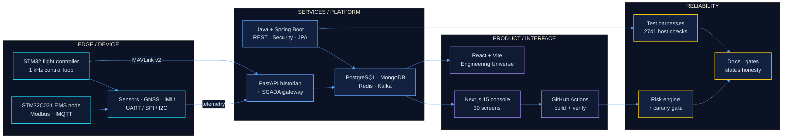

<!-- ══════════════════════════════════════════════════════════════════════════════
     MADAN PATEL H S — ENGINEERING DASHBOARD
     Single-file GitHub profile · hero · identity · stack · repositories · telemetry
     All project facts below are taken from the public repositories themselves.
     ══════════════════════════════════════════════════════════════════════════════ -->

  

<h3 align="center">Engineering across the stack — services, silicon and interfaces.</h3>

  
  
  
  
  

  
    <a href="#identity">01 · IDENTITY</a> &nbsp;·&nbsp;
    <a href="#stack">02 · STACK</a> &nbsp;·&nbsp;
    <a href="#repositories">03 · REPOSITORIES</a> &nbsp;·&nbsp;
    <a href="#telemetry">04 · TELEMETRY</a> &nbsp;·&nbsp;
    <a href="#architecture">05 · ARCHITECTURE</a> &nbsp;·&nbsp;
    <a href="#connect">06 · CONNECT</a>
  

  
  
  
  

---

<h2 align="center">◈ 01 · IDENTITY PANEL</h2>

  
  
  

<table>
<tr>
<td width="34%" valign="top" align="center">
  
    
  <b>MADAN PATEL H S</b> 
  <code>@Madanpatel21</code>
    
  Software Developer Embedded Systems · Multi-Stack Engineering
    
  
  
    
  Open to engineering work across software and hardware.
    
  
    <b>19</b> public repositories 
    <b>C · Java · TypeScript</b> primary languages 
    <b>Edge + enterprise</b> engineering scope
  
</td>
<td width="66%" valign="top">
  

    
  

  

    I build systems end to end: <b>Java and Spring services</b> on one side, <b>C firmware for STM32 and ESP32</b>
    on the other, and the <b>TypeScript interfaces and tooling</b> that make both observable. My foundation is
    electrical and electronics engineering, so I tend to start from the physical constraint — power, timing,
    sensors, failure modes — and design the software upward from there.
  

  

    The public work here is deliberately verifiable rather than decorative. A flight-control stack that reports
    its own hardware gates. A release-governance platform that ships with risk models and statistical canary
    checks. An industrial energy-management system with firmware, gateway, historian, SCADA and HMI in one
    repository. Each project documents what is finished, what is simulated, and what is still missing.
  

  

    
    
    
  

  

    
  

</td>
</tr>
</table>

---

<h2 align="center">◉ SYSTEM VISUAL</h2>

A 3D release control plane built in this profile — with the autonomous flight stack shown in its own card below.

  
   
  <b>DEPLOYSENTINEL</b> · release-risk control plane · Next.js 15 · Fastify · PostgreSQL 17 RLS

---

<h2 align="center">◈ 02 · TECHNICAL STACK MATRIX</h2>

Only technologies that appear in the public repositories — or in this profile's own declared stack — are listed.

<table>
<tr>
<td width="50%" valign="top">
  

  
<b>Service &amp; API engineering</b> 
  Spring Boot services with layered architecture, security and persistence — used across ContactsHub, the wallet backend, the employee system and the 700-design Java catalogue.

  

    
    
    
    
    
    
    
    
  

</td>
<td width="50%" valign="top">
  

  
<b>Microcontroller &amp; control systems</b> 
  Bare-metal fixed-priority scheduling, sensor fusion, protocol framing and telemetry — from the STM32F765 flight controller to the STM32C031 micro-grid node.

  

    
    
    
    
    
    
    
    
    
    
  

</td>
</tr>
<tr>
<td width="50%" valign="top">
  

  
<b>Persistence, caching, streams</b> 
  Relational and document stores, Redis caching, Kafka event streams and time-series-style historians, plus Python services for simulation and analytics backends.

  

    
    
    
    
    
    
    
    
    
  

</td>
<td width="50%" valign="top">
  

  
<b>Interfaces, consoles, tooling</b> 
  TypeScript monorepos and React front ends — a 30-screen App Router console, a Vite portfolio with a 3D domain universe, and reusable component work.

  

    
    
    
    
    
    
    
    
    
  

</td>
</tr>
<tr>
<td width="50%" valign="top">
  

  
<b>Build, ship, observe</b> 
  Containerised local stacks, GitHub Actions pipelines, verification-first test suites and observability wiring documented in DeploySentinel and the CI workflow in this repository.

  

    
    
    
    
    
    
    
    
  

</td>
<td width="50%" valign="top">
  

  
<b>Salesforce, and an exploration lane</b> 
  Salesforce platform skills are declared on this profile's own stack matrix: Apex, SOQL, Lightning Web Components and Salesforce DX. SAP BTP / CAP / HANA is an active exploration area with no public repository yet — so it is labelled, not claimed.

  

    
    
    
    
    
  

</td>
</tr>
</table>

---

<h2 align="center">◈ 03 · REPOSITORY SHOWCASE</h2>

All 19 public repositories are listed below. Status labels come from each repository's own README, manifests and file tree.

### ▍ FLAGSHIP SYSTEMS

<table>
<tr>
<td width="70%" valign="top">
  

    
    
    
  

  

    <a href="https://github.com/Madanpatel21/Autonomous-Drone-Flight-Controller-Edge-AI-Obstacle-Avoidance-"><b>Autonomous Drone Flight Controller &amp; Edge-AI Obstacle Avoidance</b></a>
  

  

    A quadcopter flight stack built from requirements up: 1&nbsp;kHz rate loop, 250&nbsp;Hz attitude loop,
    quad-X mixer, DShot600 output, GNSS/baro/IMU localisation, mission state machine with geofence and
    RTL/LAND/ABORT failsafe paths, a bounded advisory perception layer, MAVLink v2 link and a Python
    ground station. Developed against SIM and host-HIL targets so the control code is verifiable before
    hardware exists — 2,741 checks and 8 fault scenarios pass on the host.
  

  

    
    
    
    
    
  

  
No STM32 firmware image, PCB, AI model or flight test is claimed — the repository gates those itself.

</td>
<td width="30%" valign="top" align="center">
  
</td>
</tr>
</table>

<table>
<tr>
<td width="100%" valign="top">
  

    
    
    
  

  

    <a href="https://github.com/Madanpatel21/DeploySentinel"><b>DeploySentinel — Release Risk &amp; SRE Control Plane</b></a>
  

  

    A DevSecOps control plane for pre-release risk: an eight-factor risk engine over code churn, critical
    paths, blast radius, SQL lock hazards, SBOM CVEs, infrastructure drift and test gaps, followed by a
    statistical canary gate (Welch t-test) and human-in-the-loop rollout control. TypeScript npm-workspaces
    monorepo — Next.js 15 console, Fastify API, PostgreSQL 17 with row-level security, 27 tables,
    9-role RBAC with 32 scopes, TOTP MFA and hash-chained audit.
  

  

    
    
    
    
    
  

  
30 console screens implemented and verified; the repository's own implementation log records phases 0–20 complete.

</td>
</tr>
</table>

<table>
<tr>
<td width="50%" valign="top">
  

    
    
  

  

    <a href="https://github.com/Madanpatel21/Hybrid-Portable-Micro-grid-Design-Using-AI"><b>Hybrid Portable Micro-grid · Industrial EMS</b></a>
  

  

    An energy-management stack in one repository: STM32C031 firmware rebuilt from a project-local toolchain
    (64.9% flash / 28.5% RAM), a smart-grid edge gateway bridging a wire protocol to MQTT, a deterministic
    device simulator, a FastAPI backend with a WAL-mode historian and WebSocket dashboard, and a SCADA
    service with SVG mimic HMI, Modbus TCP, alarms and four RBAC roles.
  

  

    
    
    
    
    
  

  
Board bring-up and sensor calibration remain — stated in the project's own tracker.

</td>
<td width="50%" valign="top">
  

    
    
  

  

    <a href="https://github.com/Madanpatel21/ContactsHub"><b>ContactsHub — Contact Management API</b></a>
  

  

    A contact-management backend on Spring Boot 3.x and Java 21: MongoDB document model, Redis caching,
    Kafka event streaming, MapStruct mapping, validation, geospatial "nearby" queries, pagination and
    free-text search, Spring AI hooks, interactive API docs and a CI workflow.
  

  

    
    
    
    
    
    
  

  
Includes GitHub Actions CI, Maven wrapper and a documented API quick reference.

</td>
</tr>
</table>

### ▍ ENGINEERING PLATFORMS &amp; PORTFOLIOS

<table>
<tr>
<td width="34%" valign="top">
  

  
<a href="https://github.com/Madanpatel21/Java-Project-portfolio"><b>Java Project Portfolio</b></a>

  
A catalogue of exactly 700 industrial-grade Java 21 / Spring Boot system designs across twelve domains, with a machine-readable index and implemented codebases under <code>projects/</code>.

  

</td>
<td width="33%" valign="top">
  

  
<a href="https://github.com/Madanpatel21/Madanpatel21"><b>Madanpatel21 — Profile &amp; Engineering Universe</b></a>

  
This profile repository, plus <code>engineering-universe/</code>: a React + TypeScript + Vite portfolio with a React Three Fiber domain scene, ten engineering domains and a 100-record project catalogue, built and screenshot-tested by GitHub Actions.

  

</td>
<td width="33%" valign="top">
  

  
<a href="https://github.com/Madanpatel21/Madan-Patel"><b>Madan-Patel — Legacy Profile</b></a>

  
An earlier profile README: animated banner, stack matrix and analytics widgets. Kept as the historical version of the profile presentation.

  

</td>
</tr>
</table>

### ▍ APPLICATION BUILDS

<table>
<tr><td width="26%" valign="top"><a href="https://github.com/Madanpatel21/walletapplication"><b>walletapplication</b></a> Java 17 · Maven</td>
<td valign="top">Spring Boot wallet service with Spring Security, JWT, Spring Data JPA over PostgreSQL, and a Razorpay payment integration.</td>
<td width="14%" align="right"></td></tr>
<tr><td valign="top"><a href="https://github.com/Madanpatel21/emp_management_system"><b>emp_management_system</b></a> Java 17 · Maven</td>
<td valign="top">Spring Boot employee-management application using Spring Data JPA, bean validation, MySQL and Lombok.</td>
<td align="right"></td></tr>
<tr><td valign="top"><a href="https://github.com/Madanpatel21/geolocation_fetcher"><b>geolocation_fetcher</b></a> Java · Maven</td>
<td valign="top">A compact Maven utility that resolves location data over HTTP and parses the JSON response.</td>
<td align="right"></td></tr>
<tr><td valign="top"><a href="https://github.com/Madanpatel21/Student_Grade_Tracker"><b>Student_Grade_Tracker</b></a> Java</td>
<td valign="top">Console application that stores student grades in <code>ArrayList</code> collections and reports average, highest and lowest scores.</td>
<td align="right"></td></tr>
<tr><td valign="top"><a href="https://github.com/Madanpatel21/CHAT_BOT"><b>CHAT_BOT</b></a> Java</td>
<td valign="top">A console chatbot that answers from a <code>Map</code>-based response table — an early Java collections exercise.</td>
<td align="right"></td></tr>
</table>

### ▍ OPEN SOURCE, FORKS &amp; PRACTICE

<table>
<tr><td width="26%" valign="top"><a href="https://github.com/Madanpatel21/validatorjs"><b>validatorjs</b></a> JavaScript · fork</td>
<td valign="top">Fork of <i>mikeerickson/validatorjs</i> — a data-validation library for the browser and Node.js modelled on Laravel's validator, with Karma specs.</td>
<td width="16%" align="right"></td></tr>
<tr><td valign="top"><a href="https://github.com/Madanpatel21/components-js"><b>components-js</b></a> TypeScript · fork</td>
<td valign="top">Fork of <i>dTelecom/components-js</i> — React components and Next.js examples for real-time communication UIs.</td>
<td align="right"></td></tr>
<tr><td valign="top"><a href="https://github.com/Madanpatel21/runanywhere-sdks"><b>runanywhere-sdks</b></a> Kotlin · fork</td>
<td valign="top">Fork of <i>RunanywhereAI/runanywhere-sdks</i> — a toolkit for running AI models on-device, with Android and Swift packaging.</td>
<td align="right"></td></tr>
<tr><td valign="top"><a href="https://github.com/Madanpatel21/Hacktoberfest2k25-Open-source-"><b>Hacktoberfest2k25-Open-source-</b></a> Multi-language · fork</td>
<td valign="top">Fork of <i>DHEERAJHARODE/Hacktoberfest2025-Open-source-</i> — a large open-source contribution sandbox spanning C, C++, Java, Python and JavaScript.</td>
<td align="right"></td></tr>
<tr><td valign="top"><a href="https://github.com/Madanpatel21/dsa-code"><b>dsa-code</b></a> C++ · fork</td>
<td valign="top">Fork of <i>ghostmkg/dsa-code</i> — DSA problem sets organised by language (Java, C, C++, Python, Go, Kotlin, Rust, PHP, Ruby) for interview practice.</td>
<td align="right"></td></tr>
<tr><td valign="top"><a href="https://github.com/Madanpatel21/DSA"><b>DSA</b></a> README only</td>
<td valign="top">Data-structures and algorithms practice repository, currently at its initial README stage.</td>
<td align="right"></td></tr>
</table>

### ▍ RESEARCH CONCEPT

<table>
<tr><td width="32%" valign="top"><a href="https://github.com/Madanpatel21/Privacy-Preserving-Federated-Adversarial-Resilient-ADAS-Network"><b>Privacy-Preserving Federated ADAS Network</b></a> </td>
<td valign="top">A described architecture for a decentralised, federated, adversarial-resilient ADAS ecosystem. The repository is currently a scaffold with a concept description and no committed implementation — presented here as a research direction, not a delivered system.</td></tr>
</table>

---

<h2 align="center">◈ 04 · GITHUB TELEMETRY</h2>

Live contribution signal pulled from public GitHub widget services for <code>Madanpatel21</code>.

  CONTRIBUTION HEATMAP · LAST 12 MONTHS 
  

  CURRENT &amp; LONGEST STREAK 
  

  

<table>
<tr>
<td width="50%" align="center" valign="top">
  
</td>
<td width="50%" align="center" valign="top">
  
</td>
</tr>
</table>

  

  
  

---

<h2 align="center">◈ 05 · ENGINEERING MAP</h2>

How the disciplines in this profile connect — device layer, service layer, product layer, delivery layer.

<table>
<tr>
<td width="50%" valign="top">
    
  Host-side harnesses, regression runners and audits before hardware. The flight stack's 2,741 checks and DeploySentinel's 16 Vitest suites are the pattern, not the exception.
</td>
<td width="50%" valign="top">
    
  Every project publishes its gates: <code>IMPLEMENTATION_STATUS.md</code>, <code>EMS_IMPLEMENTATION_STATUS.md</code>, RC notes. Simulated is labelled simulated.
</td>
</tr>
<tr>
<td width="50%" valign="top">
    
  Requirements → architecture → interface contracts → failure modes. Firmware, protocol, service and UI are designed as one system with explicit boundaries.
</td>
<td width="50%" valign="top">
    
  Runbooks, API specs, threat models, seed data and one-command local stacks — so someone else can operate the thing without the author in the room.
</td>
</tr>
</table>

---

<h2 align="center">◈ 06 · CONNECT</h2>

<table>
<tr>
<td width="50%" valign="top" align="center">
  <h3>LINKEDIN</h3>
  Professional profile · verified link  
  
</td>
<td width="50%" valign="top" align="center">
  <h3>GITHUB</h3>
  All repositories · issues · discussions  
  
</td>
</tr>
</table>

No public email address is published on this profile — LinkedIn is the fastest verified route.

  

